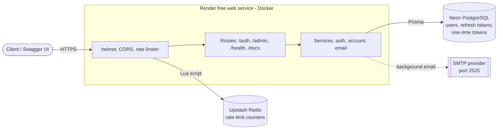

# Auth Service

Reusable authentication and authorization API built with TypeScript, Express, PostgreSQL and Redis.

> Work in progress. This README is expanded as each build step lands.

## Status

- [x] Step 1: Project scaffold (config, logging, error handling, health check, Docker, CI)
- [x] Step 2: Database schema and migrations (Prisma)
- [x] Step 3: Register and login
- [x] Step 4: JWT access + refresh token rotation
- [x] Step 5: RBAC middleware
- [x] Step 6: Email verification and password reset
- [x] Step 7: Rate limiting and lockout
- [x] Step 8: Tests, Swagger docs
- [x] Step 9: Architecture diagram and deployment

## Architecture



Deploy it for free on Render + Neon + Upstash: see [docs/DEPLOYMENT.md](docs/DEPLOYMENT.md) and `render.yaml`. The free web service sleeps after 15 minutes idle, so the first request can take about a minute.

## Quick start

```bash
cp .env.example .env
npm install
npm run dev
curl http://localhost:3000/health
```

With Docker (API + PostgreSQL + Redis):

```bash
cp .env.example .env
docker compose up --build
```

## Database

PostgreSQL via Prisma. Start the databases, then apply migrations:

```bash
docker compose up -d postgres redis
npm run prisma:generate
npm run db:migrate        # dev: applies migrations and keeps the client in sync
```

| Table | Purpose |
| --- | --- |
| `users` | Accounts: email, password hash, role, verification state, lockout counters |
| `refresh_tokens` | Hashed refresh tokens grouped by `family_id` for rotation and reuse detection |
| `verification_tokens` | Hashed one-time tokens for email verification and password reset |
| `audit_logs` | Append-only auth event history |

Design notes:
- Raw tokens are never stored, only SHA-256 hashes.
- A refresh token that is presented after it was rotated revokes its whole family.
- Deleting a user cascades to tokens; audit logs keep their rows with `user_id` set to null.

## API

**Interactive docs:** run the app and open <http://localhost:3000/docs> (Swagger UI: read the descriptions, press **Authorize** to paste an access token, and use **Try it out**). The machine-readable spec is at `/openapi.json`, for client generators, Postman and linters.

- Docs are on by default, except when `NODE_ENV=production`, where they stay off unless you set `API_DOCS_ENABLED=true` (do that on a demo deployment; leave it off if the API is private).
- Swagger UI is served from the app's own files, not a CDN, so it works under the strict security headers (`helmet`) and offline.
- **The docs can't silently go stale.** Request bodies, query and path parameters are generated from the same zod schemas that validate them at runtime. The responses are written in `src/docs/openapi.ts`, and `tests/openapi.test.ts` fails if a route is undocumented or documented but missing, if a protected route isn't marked as needing a token, or if a real response differs from the spec in status, headers or JSON shape. **When you add an endpoint, add it to `openapi.ts`.**

| Method | Path | Description |
| --- | --- | --- |
| GET | `/health` | Liveness check |
| POST | `/auth/register` | Create an account (`email`, `password` of 10-128 chars) |
| POST | `/auth/login` | Verify credentials, start a session, return `accessToken` + `refreshToken` |
| POST | `/auth/refresh` | Exchange a refresh token for a new pair (rotation) |
| POST | `/auth/logout` | End the session that owns the given refresh token (idempotent, 204) |
| POST | `/auth/logout-all` | End every session for the signed-in user (Bearer token required) |
| GET | `/auth/me` | Current user (Bearer token required) |
| POST | `/auth/verify-email` | Confirm an email address with the emailed token (`{ "token": "..." }`) |
| POST | `/auth/resend-verification` | Send a new verification email (always 202, see below) |
| POST | `/auth/forgot-password` | Email a password reset link (always 202, see below) |
| POST | `/auth/reset-password` | Set a new password with the emailed token (`{ "token", "password" }`) |
| GET | `/admin/users?page=1&limit=20` | List users (admin only; limit max 100) |
| PATCH | `/admin/users/:id/role` | Change a user's role to `USER` or `ADMIN` (admin only) |

```bash
curl -X POST localhost:3000/auth/register \
  -H 'Content-Type: application/json' \
  -d '{"email":"ada@example.com","password":"a-strong-passphrase"}'

curl -X POST localhost:3000/auth/login \
  -H 'Content-Type: application/json' \
  -d '{"email":"ada@example.com","password":"a-strong-passphrase"}'
# => { "user": {...}, "accessToken": "...", "refreshToken": "...", "tokenType": "Bearer", "expiresIn": 900 }

curl localhost:3000/auth/me -H "Authorization: Bearer $ACCESS_TOKEN"
```

### Roles and access control

Two roles: `USER` (default) and `ADMIN`. Protect a route by chaining middleware:

```ts
router.get('/reports', authenticate, requireRole('ADMIN'), handler);
```

- `authenticate` verifies the access token and sets `req.auth` (`userId`, `role`). `requireRole(...)` returns 403 unless the role matches. Every denial is written to the audit log as `ACCESS_DENIED`.
- Everything under `/admin` is admin-only. Public registration always creates a `USER`; a `role` field in the request body is ignored.
- **Bootstrapping the first admin:** there is intentionally no API for it. Run the seed script once:

  ```bash
  ADMIN_EMAIL=you@example.com ADMIN_PASSWORD='a-long-unique-passphrase' npm run db:seed:admin
  # in a built container: node dist/scripts/seedAdmin.js
  ```

  It is idempotent, applies the same password rules as registration, and promotes an existing account without touching its password.
- **Role changes** revoke the target user's sessions, so the new role takes effect at their next login or refresh, and a demoted admin can't keep refreshing. Every change is audited as `ROLE_CHANGED`.
- **Lockout protection:** an admin cannot change their own role, so the last admin can't remove themselves.

Trade-off: the role is read from the signed access token (no database hit per request). After a role change, an already-issued access token keeps its old role until it expires (at most 15 minutes). If that window is unacceptable for a route, look the role up in the database for that route.

### Email verification and password reset

Registration sends a verification email. Links point at your frontend: `APP_BASE_URL/verify-email?token=...` and `APP_BASE_URL/reset-password?token=...`. The frontend reads the token from the URL and calls the matching endpoint.

- **One-time tokens:** 256-bit random values, stored only as SHA-256 hashes, valid once, and expiring after 24 hours (verification, `EMAIL_VERIFICATION_TTL_HOURS`) or 60 minutes (reset, `PASSWORD_RESET_TTL_MINUTES`). Requesting a new email invalidates the previous link of that type. Unknown, expired, used and wrong-type tokens all return the same `400 INVALID_TOKEN`, and a verification token can't be used to reset a password or the reverse.
- **Concurrency-safe:** a token is claimed with a compare-and-set inside a transaction, so two simultaneous requests with the same link can't both succeed.
- **No account enumeration:** `/auth/resend-verification` and `/auth/forgot-password` return the same `202` body whether or not the account exists, and do their work (and the sending) after the response, so response time doesn't reveal it either.
- **Resetting a password** signs the user out everywhere (all refresh tokens revoked), clears failed-login counters and any lockout, marks the address verified (they proved they own the mailbox), and emails the owner a "your password was changed" notice. A weak new password is rejected before the token is used up, so the link still works for a retry.
- **`REQUIRE_EMAIL_VERIFICATION`** (default `false`): when `true`, login returns `403 EMAIL_NOT_VERIFIED` for unverified accounts, but only after the correct password, so it can't be used to find out which emails are registered.
- **Email delivery:** `EMAIL_TRANSPORT=console` prints emails to the log for local development and is refused when `NODE_ENV=production`, because the log would then contain live links. In production use `EMAIL_TRANSPORT=smtp` with `SMTP_HOST`, `SMTP_PORT`, `SMTP_USER`, `SMTP_PASS`, `SMTP_SECURE` and `EMAIL_FROM`.

Trade-offs:
- Emails are sent from an in-process background task. If the process crashes mid-send the email is lost and nothing retries; the user can request another. A durable queue is the production upgrade, and shutdown waits for in-flight sends.
- The two endpoints that send email are limited per IP and per address (see "Rate limiting and account lockout"), so an inbox can't be flooded.

### Rate limiting and account lockout

Two layers, because they stop different attacks.

**Rate limits** (per client IP, fixed windows, counted in Redis so they hold across instances):

| Route | Limit |
| --- | --- |
| All routes except `/health` | 300 per 15 min |
| `POST /auth/login` | 20 per 15 min |
| `POST /auth/register` | 10 per hour |
| `POST /auth/refresh` | 100 per 15 min |
| `POST /auth/verify-email`, `/auth/reset-password` | 10 per 15 min each |
| `POST /auth/forgot-password`, `/auth/resend-verification` | 10 per hour per IP **and** 3 per hour per email address |

- Exceeding a limit returns `429 TOO_MANY_REQUESTS` with a `Retry-After` header. Every counted response carries `RateLimit-Limit`, `RateLimit-Remaining` and `RateLimit-Reset`.
- The per-address limit applies whether or not the account exists, so it reveals nothing, and it keeps someone from flooding a victim's inbox from many IPs. Addresses are hashed in Redis keys.
- The counter is one atomic Lua script (increment plus expiry), so a crash can't leave a key that never expires, and concurrent requests are counted exactly.
- IPv6 clients are grouped by /64 (one subscriber usually owns a whole /64, so per-address keys would be trivial to rotate). IPv4-mapped IPv6 and a trailing source port are normalized away.
- **Fails open:** if Redis is unreachable, requests go through (with a rate-limited warning in the log) rather than taking sign-in down. Brute-force protection survives that, because lockout lives in PostgreSQL.

**Account lockout** (per account, in the database):

- After `MAX_FAILED_LOGINS` (default 5) wrong passwords, the account locks for `LOCKOUT_MINUTES` (default 15).
- While locked, even the correct password gets the same generic `401` as a wrong one, with similar response time, so a lock doesn't reveal that the account exists. The owner gets an email, and `ACCOUNT_LOCKED` / `LOGIN_BLOCKED` audit events are written.
- A successful login resets the counter. A password reset lifts the lock. Unknown emails are never counted.
- The counter is an atomic SQL increment and the lock is a compare-and-set, so parallel guesses can't slip past the limit, and a race to cross it locks, audits and emails exactly once.

Settings (all in `.env.example`):

| Variable | Default | Meaning |
| --- | --- | --- |
| `RATE_LIMIT_ENABLED` | `true` | Turn rate limiting off (e.g. in a local load test) |
| `RATE_LIMIT_STORE` | `redis` | `redis` for production; `memory` is per process and multiplies the limit across instances |
| `TRUST_PROXY` | `0` | How many reverse proxies sit in front of the app |
| `MAX_FAILED_LOGINS` | `5` | Wrong passwords before lockout |
| `LOCKOUT_MINUTES` | `15` | Lock duration |

**Set `TRUST_PROXY` correctly when deployed.** Behind a load balancer or a platform front end (Azure App Service usually counts as one hop, so `1`), the app sees the proxy's address, and every user would share one rate-limit bucket. Set it to the number of proxies you control, and no higher: a larger value lets clients spoof `X-Forwarded-For` and pick their own bucket. Check by logging `req.ip` from a real request.

Trade-offs:
- Lockout can be used against its owner: someone who knows your email can lock you out by guessing wrongly. The lock is short, the owner is emailed, a password reset lifts it, and the per-IP login limit slows the attacker. Raising `MAX_FAILED_LOGINS` or adding CAPTCHA after a few failures are the usual refinements.
- Fixed windows allow a burst at a window boundary (up to twice the limit across it). A sliding window or token bucket smooths that out at the cost of a more complex script.

### Token design

| | Access token | Refresh token |
| --- | --- | --- |
| Format | Signed JWT (HS256) with `sub`, `role`, `iss`, `exp` | Opaque random string (256 bits) |
| Lifetime | 15 minutes (`ACCESS_TOKEN_TTL_SECONDS`) | 7 days absolute (`REFRESH_TOKEN_TTL_DAYS`) |
| Stored server-side | No (stateless verification) | Yes, as a SHA-256 hash only |
| Revocable | Only by expiring | Yes, immediately |

- **Rotation:** every `/auth/refresh` revokes the presented token and issues a new one in the same *family* (one login session). The swap is a compare-and-set inside a transaction, so two concurrent requests with the same token cannot both succeed.
- **Reuse detection:** presenting an already-rotated token means a copy exists somewhere it shouldn't, so the whole family is revoked and a `REFRESH_REUSE_DETECTED` audit event is written. Tokens revoked by logout are rejected without raising this alarm.
- **Absolute session lifetime:** a rotated token inherits the original expiry, so a session can't be extended forever by refreshing.
- **Verification hardening:** the algorithm is pinned to HS256 (blocks `alg: none` and algorithm confusion), the issuer is checked, and unknown roles are rejected.
- **No default secret:** `JWT_ACCESS_SECRET` (32+ chars) is required, and the app refuses to start without it. Generate one with `openssl rand -base64 48`.
- **Responses with tokens** carry `Cache-Control: no-store`; 401s include `WWW-Authenticate: Bearer`.

Trade-offs:
- Access tokens stay valid until they expire even after logout (stateless). The 15-minute lifetime bounds the exposure; a deny-list in Redis is the usual upgrade if instant revocation is needed.
- Strict reuse detection means a client that loses the response to a refresh and retries with the old token gets its session revoked. A short grace window is a possible refinement.
- Refresh tokens are returned in the JSON body, which suits API and mobile clients. A browser-only app would prefer an `HttpOnly` cookie.

Errors share one shape: `{ "error": { "code": "...", "message": "...", "details": [...] } }`.

Security decisions:
- Passwords are hashed with argon2id; the plaintext is never stored or logged (logger redacts it).
- Login returns the same generic 401 for an unknown email and a wrong password, and runs a dummy hash check for unknown emails so response times don't reveal which accounts exist.
- Responses use an explicit whitelist (`toPublicUser`), so the password hash can't leak by accident.
- Registration returns 409 for a taken email. That reveals the email is registered, a deliberate usability trade-off; the fully private alternative is a generic response plus an email to the owner (now possible since email exists, but not implemented here).
- Every register and login attempt is written to `audit_logs`. A failed audit write is logged but never breaks the request.

## Scripts

| Command | Purpose |
| --- | --- |
| `npm run dev` | Start with hot reload |
| `npm run build` | Compile TypeScript to `dist/` |
| `npm start` | Run the compiled build |
| `npm run prisma:generate` | Generate the Prisma client |
| `npm run db:migrate` | Create/apply migrations in development |
| `npm run db:deploy` | Apply migrations in production |
| `npm run db:seed:admin` | Create the first admin (needs `ADMIN_EMAIL`, `ADMIN_PASSWORD`) |
| `npm run lint` | ESLint |
| `npm run typecheck` | TypeScript type check |
| `npm test` | Run tests |
| `npm run test:coverage` | Run tests with coverage |

## License

MIT
