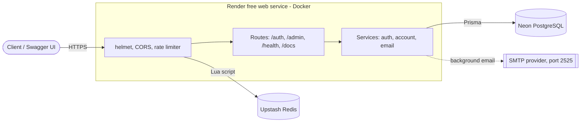

# Deployment: Render + Neon + Upstash (all free tiers)

Free-tier limits below come from each vendor's docs at the time of writing. Re-check them before relying on them.

## 1. Neon (PostgreSQL)

1. Create a project and copy the **direct** connection string: the host has **no** `-pooler`. Neon's Prisma guide says `prisma migrate` needs a direct connection, and the container runs `prisma migrate deploy` on every start.
2. Append `?sslmode=require&connect_timeout=15`. Neon scales to zero when idle; the longer timeout stops the first request after a pause failing with Prisma `P1001: Can't reach database server`.
3. This value becomes `DATABASE_URL`.

## 2. Upstash (Redis)

1. Create a database and copy the **TCP** URL, which starts with `rediss://` (TLS). Use that as `REDIS_URL`; `ioredis` accepts it as is.
2. The rate limiter relies on a Lua script (`EVAL`). Upstash documents EVAL as supported. If it ever fails, the limiter fails open (requests are allowed), so check the logs rather than assuming limits are enforced.

## 3. SMTP provider

`EMAIL_TRANSPORT=console` is refused in production, so a real SMTP account is required.

**Render's free web services block outbound traffic on ports 25, 465 and 587.** Use a provider that offers an alternate port, commonly 2525, with STARTTLS (`SMTP_SECURE=false`). Brevo's free plan allows 300 emails/day; confirm the host, port and credentials in its "SMTP & API" page (I could not verify port 2525 from its public docs). `EMAIL_FROM` must be a sender the provider has verified.

## 4. Render

1. Push this repo to GitHub.
2. Render dashboard, **New, Blueprint**, select the repo. `render.yaml` defines the service.
3. Fill in the prompted values:

| Variable | Value |
| --- | --- |
| `DATABASE_URL` | Neon direct URL from step 1 |
| `REDIS_URL` | Upstash `rediss://` URL |
| `APP_BASE_URL` | `https://<service-name>.onrender.com` |
| `EMAIL_FROM`, `SMTP_HOST`, `SMTP_USER`, `SMTP_PASS` | From your SMTP provider |

`JWT_ACCESS_SECRET` is generated by Render. The rest are preset in `render.yaml`.

4. After the first deploy: `https://<service>.onrender.com/health`, then `/docs`.
5. To create the first admin, run `ADMIN_EMAIL=... ADMIN_PASSWORD=... npm run db:seed:admin` from your own machine with `DATABASE_URL` pointing at Neon. (Render's free tier has no shell.)

## Caveats

- **Cold starts.** After 15 minutes without traffic the service spins down; waking takes about a minute. Mention it in your README or pin a note, so a reviewer who sees a slow first load knows why.
- **Lost emails.** Emails are sent in the background inside the process. If the instance is stopped mid-send, that email is lost. A queue would fix this; it is out of scope here.
- **Email links.** Emails link to `APP_BASE_URL/verify-email?token=...` and `/reset-password?token=...`. This repo is API-only, so those pages don't exist. For a demo, copy the `token` from the link and `POST` it to `/auth/verify-email` or `/auth/reset-password` in Swagger UI. `REQUIRE_EMAIL_VERIFICATION=false` in `render.yaml` keeps login working without that step.
- **Client IPs.** Rate limiting keys on `req.ip`, which depends on `TRUST_PROXY`. A Render community thread reports that Render appends the proxy IP to `X-Forwarded-For` without stripping client-supplied values, and the hop count is not documented. `1` is a starting point, not a verified value. To check: call `/auth/login` repeatedly from two networks and confirm limits are counted per client, and that a spoofed `X-Forwarded-For` header does not reset them. If every client shares one limit, the hop count is too low.
- **Free-tier ceilings.** 750 instance hours per month per workspace, 512 MB RAM, Neon 1 GB storage, Upstash 500K commands/month.
- **Not verified here.** I could not run Docker, Prisma migrations, or any of these three services from my workspace, so this setup is untested end to end. The first deploy is the real test.
